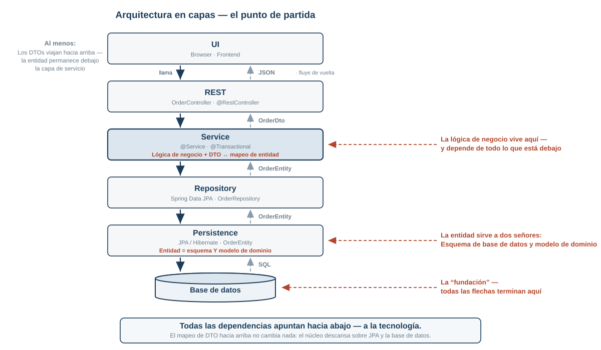

<!-- _class: lead -->
<!-- _paginate: false -->

# Architectura Hexagonal

## Puertos y Adaptadores con ejemplo práctico
### Java 25 · Spring Boot 4.1

<br>

<span class="muted">Primero, la forma pura; después, Clean Architecture y DDD como etapas de expansión.</span>

<!--
Welcome. Setup in two sentences: Everything you're about to see on the slides
is copied from three runnable Maven projects - example-pure, example-clean,
example-ddd. All tests green.

The dramaturgy of this talk (different from v1): We first build the PURE FORM
of Hexagonal - just ports and adapters, nothing else. No DDD, no use cases,
no events. Only once that has sunk in do I show what Clean Architecture and
DDD add on top - each with code. That way you see which concept solves which
problem, instead of swallowing everything at once.
-->

---

## Agenda

- De dónde proviene el dolor
- La idea: puertos, adaptadores, una regla
- El código: solicitar un servicio **en su forma pura**
- La comprobabilidad como prueba
- Etapa de expansión: Arquitectura limpia (Clean Architecture)
- Etapa de expansión: DDD: agregado + eventos
- **Discusión**

<!--
Say this out loud on purpose: The discussion is planned in, not whatever time
is left over. Interrupting questions welcome at any time, note down the big
ones.

The common thread: three stages that build on each other. Stage 1 takes the
most time, because it contains the actual idea. Stages 2 and 3 are then each
just a delta.
-->

---

## Las capas que todos conocemos

<style scoped>img { display: block; margin: 4px auto 0; }</style>



<!--
The starting point almost everyone in the room has built: UI, REST, service,
repository, persistence, database. Walk through it top to bottom.

Stay fair: This architecture isn't sloppy. There are DTOs going upward - the
controller never sees an entity, the mapping sits cleanly in the service. The
entity stays below the service layer. That's how most teams do it, and it
works.

The three red annotations are the point:
1. The business logic lives in the @Service - and that depends on EVERYTHING
   below it. No test without Spring, no compiling without JPA.
2. The entity serves two masters: it is the DB schema AND the domain model.
   Every schema change is a domain change and vice versa.
3. All arrows end at the database - it's the foundation everything
   stands on.

Transition: Let's look inside the middle layer - this is what the service
in there looks like.
-->

---

## Así es como funciona el servicio allí dentro.

```java
@Service
public class OrderService {

    @Autowired private OrderRepository repository;      // JPA
    @Autowired private StripeClient stripe;             // HTTP
    @Autowired private KafkaTemplate<String, String> kafka;

    @Transactional
    public OrderDto placeOrder(OrderDto dto) {
        OrderEntity entity = new OrderEntity();
        entity.setCustomerId(dto.getCustomerId());
        entity.setTotal(dto.getItems().stream()
                .map(i -> i.getPrice().multiply(BigDecimal.valueOf(i.getQuantity())))
                .reduce(BigDecimal.ZERO, BigDecimal::add));
        if (entity.getTotal().compareTo(new BigDecimal("10000")) > 0) {
            throw new ResponseStatusException(HttpStatus.UNPROCESSABLE_ENTITY);
        }
        Charge charge = stripe.charge(entity.getTotal(), "chf");
        entity.setStatus("PAID");
        kafka.send("orders", entity.getId().toString());
        return OrderMapper.toDto(repository.save(entity));
    }
}
```

<!--
This is not a straw man - this is the majority of codebases out there, and
it works fine at first. Don't put it down; instead, let people ask: What
specifically bothers us here?

Deliberately built fairly: The service returns a DTO, the entity never leaves
the layer - the mapping in the last line is standard. So the problem with
this code is NOT a missing DTO. It's what happens between the first and the
last line: a business rule squeezed between Stripe and Kafka, an HTTP status
inside the rule, the entity as the working model.

Phrase it for experienced devs: not "this is bad", but "this has a price you
only start to feel beyond a certain size". Let the audience look for the
answers themselves briefly before the next slide gives them away.
-->

---

## Lo que duele de ello más tarde

- La regla de negocio se sitúa **entre Stripe y Kafka**
- Entidad = **esquema de base de datos y modelo de dominio** a la vez
- **Estado HTTP** dentro de la regla de negocio
- Prueba = **contexto de Spring** + tres mocks

<br>

> Una causa: **El núcleo conoce el mundo exterior.**

<!--
Four symptoms, one cause - the sentence at the bottom is the transition to
the idea.

Spell it out on the audio track:
1. Nobody looking for the 10,000 rule will find it - it sits in the middle
   of infrastructure code.
2. Every schema change is automatically a domain change and vice versa -
   the entity serves two masters.
3. ResponseStatusException inside the rule: How does a batch job call this?
   It has no HTTP status.
4. For a rounding rule we boot 3 seconds of Spring context. Everyone knows
   the test suite that runs 8 minutes because everything is @SpringBootTest -
   this point resonates most with an experienced audience.
-->

---

## The idea (Alistair Cockburn, 2005)

> "Allow an application to equally be driven by users, programs, automated test
> or batch scripts, and to be developed and tested in isolation from its
> eventual run-time devices and databases."

<br>

- Original name: **Ports and Adapters**
- The database is an **accessory**, not a foundation

<!--
Cockburn 2005, "Hexagonal" was just the nickname - the number six means
nothing. The hexagon only says: there are several sides, and none of them is
privileged.

The shift in perspective is in the second bullet: In classic layering the
database sits at the bottom and carries everything. Here it hangs on the
outside like a device you plug in. Anyone who takes away this one thought has
understood half the talk.
-->

---

<!-- _footer: '' -->

## The picture

<style scoped>img { display: block; margin: 4px auto 0; }</style>


<!--
Walk along the picture, left to right. The most important difference from
layered architecture: no more top/bottom, but inside/outside.

The red dashed line on the right is the actual content of this slide: The
CALL goes outward (the core wants to save, wants to charge), the DEPENDENCY
points inward (the adapter implements an interface that lives in the core).
On the left both directions coincide, which is why nobody notices it there -
and why the right-hand side is built wrong so often.

The gray boxes on the left (BatchJob, test code) don't exist in the example,
but could be plugged in without any change to the core - exactly Cockburn's
sentence from a moment ago.
-->

---

## Not all ports are the same

<div class="cols">
<div>

### Driving Port (left)
```java
public interface OrderService {
    UUID placeOrder(String customerId,
                    String currency,
                    List<OrderLine> lines);
    void cancelOrder(UUID orderId, String reason);
    Order getOrder(UUID orderId);
}
```
Core implements · adapter calls

</div>
<div>

### Driven Port (right)
```java
public interface PaymentPort {
    String charge(UUID orderId,
                  BigDecimal amount,
                  String currency);
    void refund(String paymentReference);
}
```
Adapter implements · core calls

</div>
</div>

<br>

> `PaymentPort`, not `StripeClient`.

<!--
Here sits the most common misunderstanding: Just putting "interfaces in front
of everything" does not give you a hexagonal architecture yet.

Driving port: describes WHAT you can do with the system - the domain language
of the use cases. Driven port: describes what the core NEEDS from the
outside, phrased in its own language.

The takeaway line at the bottom is testable: If the port's name gives away
the vendor, it's cut wrong. charge() and refund() are domain terms -
createStripeCharge would be the vendor leaking into the core.

This is already the code from the real example project - we'll see exactly
these two interfaces again in a moment.
-->

---

## The one rule

# Dependencies point inward.

<br>

In the core, that means:

- no `org.springframework.*`
- no `jakarta.persistence.*`
- no HTTP status in exceptions

<br>

<span class="muted">Later as an executable test.</span>

<!--
If only one sentence sticks today, it's this one.

The import check is the fastest self-check there is: Open the import list of
any class in the core. If it only shows java.* and your own package, you're
on track. If it shows Spring, Jackson, or jakarta.persistence, the rule is
already broken.

Announce it: At the end of the code part we'll turn exactly this rule into a
test that runs in the build - then it's no longer a convention, it's
compiler-hard.
-->

---

## Why this works: Dependency Inversion

<div class="cols">
<div>

**Before**

```
Service ──────▶ StripeClient
   (core)         (tech)
```

</div>
<div>

**After**

```
Service ─────▶ PaymentPort
  (core)        (core!)
                   ▲
                   │ implements
              StripeAdapter
                (tech)
```

</div>
</div>

<br>

> Hexagonal = **DIP, applied consistently to every system boundary.**

<!--
For experienced devs, this is the "oh, I see" moment: The pattern isn't new.
It's the D in SOLID - applied to every single system boundary, instead of
only where it happened to be convenient.

Left: compile-time dependency pointing outward, the core cannot be built
without Stripe. Right: the arrow is reversed - the interface lives in the
core package and is phrased in the language of the domain. At runtime the
call still flows toward Stripe, but the compile dependency points inward.

The difference from "well, I did make an interface": It matters WHERE the
interface lives (in the core) and WHAT it's called (domain language).
-->

---

<!-- _class: lead -->

# The code — in its pure form

## Order service: place, query, cancel

<span class="muted">Project `example-pure` · only ports & adapters · 22 tests</span>

<!--
From here on, ideally switch to the IDE in parallel. All snippets are copied
unchanged from example-pure.

Important to announce: What comes now is DELIBERATELY minimal. No DDD, no
use-case interfaces, no command objects, no events - only what genuinely
makes up hexagonal architecture. Everything else is expansion stages that
come at the end. If someone raises their hand at "so where's the aggregate?":
it's coming, stage 3.

Order from inside to outside: domain, ports, core, wiring, adapters. That's
exactly the order you build it in, too.
-->

---

## Package structure

```
com.example.orders
├── domain                Order, OrderLine, OrderStatus
├── application
│   ├── port.in           OrderService
│   ├── port.out          OrderRepository, PaymentPort
│   └── service           DefaultOrderService
├── adapter
│   ├── in.web            OrderController, DTOs, ExceptionHandler
│   ├── in.tx             TransactionalOrderService
│   ├── out.persistence   OrderJpaEntity, Adapter, Mapper
│   └── out.payment       PspPaymentAdapter, InMemoryPaymentAdapter
└── config                ApplicationConfiguration
```

<!--
Show briefly, don't dwell on it. Three zones: domain and application are
inside (the core), adapter is outside, config is the single seam.

port.in and port.out make the direction visible in the package name - left
and right of the hexagon. I'll explain adapter.in.tx separately in a moment;
that's the transaction bracket.

If someone has multiple business areas: cut by business area FIRST, then
apply this structure per area. Otherwise you eventually end up with 200
classes from eight domains in a single adapter.out.persistence.
-->

---
<!-- _class: code -->

## The domain: own types, no technology

```java
public class Order {                       // no @Entity, no Spring

    private UUID id;
    private String customerId;
    private String currency;
    private List<OrderLine> lines;
    private OrderStatus status;
    private String paymentReference;
    // constructor, getters, setters
}

public record OrderLine(String productId, int quantity, BigDecimal unitPrice) {

    public BigDecimal subtotal() {
        return unitPrice.multiply(BigDecimal.valueOf(quantity));
    }
}
```

- Imports: only `java.*`
- Rules live in the service (for now)

<!--
Deliberately unspectacular: a data holder with setters plus a record. This is
NOT an exemplary domain model - it's the minimum that Hexagonal needs: own
types that know nothing about technology.

The important point for this stage: no @Entity, no Spring, no Jackson
annotation. The class compiles without a single framework import.

Say it honestly: With setters, anyone can construct an invalid state at any
time, and the business rules live in the service instead of the model. That's
the price of this minimal variant - and exactly the gap DDD closes in
stage 3. Deliberately plant this thread here and pick it up again at the end.
-->

---
<!-- _class: code -->

## The core: plain Java

<style scoped>pre { font-size: 15px; }</style>

```java
public class DefaultOrderService implements OrderService {   // no @Service!

    private final OrderRepository orderRepository;   // both interfaces of the core
    private final PaymentPort paymentPort;

    @Override
    public UUID placeOrder(String customerId, String currency, List<OrderLine> lines) {
        validate(customerId, currency, lines);                        // check the rules

        BigDecimal total = total(lines);
        if (total.compareTo(MAX_ORDER_VALUE) > 0)
            throw new OrderValueExceededException(total, MAX_ORDER_VALUE);

        Order order = new Order(UUID.randomUUID(), customerId, currency,
                lines, OrderStatus.PLACED, null);

        String reference = paymentPort.charge(order.getId(), total, currency);  // port!
        order.setStatus(OrderStatus.PAID);
        order.setPaymentReference(reference);

        orderRepository.save(order);                                            // port!
        return order.getId();
    }
}
```

<!--
The core class of the whole example. Show three things:

1. No @Service, no @Transactional, no @Autowired - the imports of the entire
   class are java.* plus its own packages. This class doesn't know that
   Spring exists.

2. Both dependencies are interfaces the core defines itself. Constructor
   injection, perfectly ordinary Java.

3. The flow: check, decide, then talk to the outside world through ports.
   paymentPort.charge() - the core doesn't know whether there's a PSP, a
   test double, or nothing at all behind it.

The order charge -> save is a good discussion hook: The HTTP call runs before
the save. What happens if we crash in between? Note it down for the
discussion.
-->

---
<!-- _class: code -->

## "So where is Spring now?"

<div class="cols">
<div>

```java
@Configuration
class ApplicationConfiguration {

    @Bean
    OrderService orderService(
            OrderRepository repo,
            PaymentPort payment) {
        return new TransactionalOrderService(
            new DefaultOrderService(repo, payment));
    }
}
```

</div>
<div>

```java
// adapter.in.tx
public class TransactionalOrderService
        implements OrderService {

    private final OrderService delegate;

    @Override @Transactional
    public UUID placeOrder(...) {
        return delegate.placeOrder(...);
    }
}
```

</div>
</div>

<br>

- **One** class wires core and framework together
- Transaction = decorator at the driving port

<!--
Left: The only place where core and framework meet. The core itself stays
"just Java" - bootable in milliseconds in a test.

Right: Transactions are technology, not business logic. Instead of writing
@Transactional into the core, a decorator wraps the bracket around the
driving port. It lives under adapter.in - because the transaction bracket
begins and ends with the invocation of the use case; it belongs to the
inbound side.

Moderate honestly: A great many teams put @Service and @Transactional
directly on the application service and live happily with it. What you give
up: the Spring-free core and the ArchUnit rule that goes with it. A
conscious decision, not a matter of faith.
-->

---
<!-- _class: code -->

## Driving adapter: HTTP stays outside

<style scoped>pre { font-size: 15px; }</style>

```java
@RestController @RequestMapping("/api/orders")
class OrderController {

    private final OrderService orderService;         // the interface, not the class

    @PostMapping
    ResponseEntity<Void> place(@Valid @RequestBody PlaceOrderRequest request) {
        UUID id = orderService.placeOrder(request.customerId(),
                OrderWebMapper.currency(request), OrderWebMapper.toLines(request));
        return ResponseEntity.created(URI.create("/api/orders/" + id)).build();
    }
}

@RestControllerAdvice
class OrderExceptionHandler {
    @ExceptionHandler(OrderNotCancellableException.class)
    ProblemDetail conflict(OrderNotCancellableException ex) {           // → 409
        return ProblemDetail.forStatusAndDetail(HttpStatus.CONFLICT, ex.getMessage());
    }
}
```

- Its own request DTO, its own mapper
- Business error → status code: **only here**

<!--
The controller is thin: map, call, choose a status code. An adapter is not
allowed to do more than that.

PlaceOrderRequest is a dedicated DTO, not the domain object. Whoever
serializes the domain model directly turns it into a public API - from the
first external consumer onward you can no longer rename anything internally.

The ExceptionHandler is the answer to the ResponseStatusException problem
from the first slide: The domain throws business errors, and ONLY the web
adapter translates them into HTTP. A batch adapter would translate the same
error into a log entry.

By the way: Swagger UI comes for free - springdoc reads the controllers,
localhost:8080/swagger-ui.html. Can be shown live.
-->

---
<!-- _class: code -->

## Driven adapter: its own persistence model

<style scoped>pre { font-size: 16px; }</style>

```java
@Entity @Table(name = "orders")
class OrderJpaEntity {                    // its own model, not the domain class
    @Id private UUID id;
    private String customerId;
    private String status;
    @OneToMany(mappedBy = "order", cascade = CascadeType.ALL,
            orphanRemoval = true, fetch = FetchType.EAGER)
    private List<OrderLineJpaEntity> lines = new ArrayList<>();
}

@Component
class OrderPersistenceAdapter implements OrderRepository {

    private final SpringDataOrderRepository repository;

    @Override public Optional<Order> load(UUID orderId) {
        return repository.findById(orderId).map(OrderPersistenceMapper::toDomain);
    }
    @Override public void save(Order order) {
        repository.save(OrderPersistenceMapper.toEntity(order));
    }
}
```

- Price: one mapper · Benefit: schema ≠ domain

<!--
The adapter implements the core's port (OrderRepository) and behind it uses
perfectly ordinary Spring Data. JPA annotations, lazy loading, proxies - all
of it stays in this package.

Be honest: This is the most expensive single decision in the pattern. In the
pure variant the mapper is almost a 1:1 copy - here it only partially pays
off. Where it does pay off: as soon as the domain model wants to look
different from the tables, and in completely avoiding detached-entity and
lazy-loading trouble in the core.

If someone suggests the "shortcut" of putting JPA annotations directly on
the domain class: we advise against it. JPA then dictates the model (default
constructor, proxies, mutable fields), dirty checking writes back states
nobody explicitly saved, and jakarta.persistence ends up in the core - the
dependency rule is thereby broken at its most important spot. The mapper is
the price; the separate model stays.

Why not use the Spring Data repository directly as the port? Because
JpaRepository brings 20 methods along and pulls Page<T> into the core - and
with that the dependency direction would be flipped again.
-->

---
<!-- _class: code -->

## The moment it pays off

```java
@Component @Profile("!demo")
class PspPaymentAdapter implements PaymentPort {
    public String charge(UUID orderId, BigDecimal amount, String currency) {
        ChargeResponse r = client.post().uri("/charges")
                .body(new ChargeRequest(orderId.toString(), amount, currency))
                .retrieve().body(ChargeResponse.class);
        return r.id();
    }
}

@Component @Profile("demo")
class InMemoryPaymentAdapter implements PaymentPort {
    public String charge(UUID orderId, BigDecimal amount, String currency) {
        return "demo-" + UUID.randomUUID();
    }
}
```

```bash
mvn spring-boot:run -Dspring-boot.run.profiles=demo
```

<!--
Two adapters on the same port, switched via Spring profile. Show it live
here if possible: start the app in the demo profile, place an order via
Swagger UI or curl. No PSP, no WireMock, no mock server.

The same mechanism covers: local development without third-party systems,
demo environments, and migrating from vendor A to B - both adapters side by
side in the code, switched via configuration.

This is the first tangible payoff moment of the architecture - the second
one comes right away with the tests.
-->

---

## What the structure does to the tests

| Test | Needs | Tests | Runtime |
|---|---|---|---|
| `DefaultOrderServiceTest` | fakes, no Spring | 7 | **~0.01 s** |
| `OrderControllerTest` | `@WebMvcTest` | 5 | ~0.4 s |
| `OrderPersistenceAdapterTest` | `@DataJpaTest` + H2 | 2 | ~0.1 s |
| `OrdersApplicationSmokeTest` | whole app, profile `demo` | 1 | ~1.7 s |
| `HexagonalArchitectureTest` | ArchUnit | 7 | ~0.4 s |

<br>

> Business logic: milliseconds. Technology: seconds — and it rarely changes.

<!--
Numbers from the real build of example-pure, not estimated.

The point is not "faster tests", but: The part with the highest rate of
change - the business logic - has the fastest feedback. Exactly the opposite
of the typical @SpringBootTest suite, where every rule change costs a full
context start.

For this audience, this is the strongest single argument of the talk.
-->

---
<!-- _class: code -->

## Core test: fakes instead of a mocking framework

```java
@BeforeEach void setUp() {
    repository = new InMemoryOrderRepository();     // implements OrderRepository
    payment    = new RecordingPaymentAdapter();     // implements PaymentPort
    service    = new DefaultOrderService(repository, payment);
}

@Test void placesOrder() {
    UUID id = service.placeOrder("cust-1", "CHF",
            List.of(new OrderLine("p-1", 2, new BigDecimal("12.50"))));

    assertThat(payment.charges()).containsExactly(new BigDecimal("25.00"));
    assertThat(repository.find(id)).hasValueSatisfying(o ->
            assertThat(o.getStatus()).isEqualTo(OrderStatus.PAID));
}

@Test void doesNotSaveWhenPaymentFails() {
    payment.failNext();
    assertThatThrownBy(() -> service.placeOrder(...)).isInstanceOf(PaymentFailedException.class);
    assertThat(repository.size()).isZero();
}
```

<!--
The fakes are hand-written, about 30 lines each - no Mockito. The tests read
as behavior ("when payment fails, nothing is saved"), not as a call log, and
they don't break when the call order changes.

The second test is the interesting one: a real statement about the system in
three lines, without a framework, in milliseconds. That's ONLY possible
because the ports exist - against StripeClient and JpaRepository directly,
the same test would be an integration test with WireMock and H2.
-->

---
<!-- _class: code -->

## The rule becomes executable: ArchUnit

```java
@ArchTest
static final ArchRule domain_is_free_of_technology =
        noClasses().that().resideInAPackage("..domain..")
                .should().dependOnClassesThat().resideInAnyPackage(
                        "org.springframework..", "jakarta.persistence..");

@ArchTest
static final ArchRule application_is_free_of_spring =
        noClasses().that().resideInAPackage("..application..")
                .should().dependOnClassesThat().resideInAnyPackage(
                        "org.springframework..", "jakarta.persistence..");

@ArchTest
static final ArchRule application_knows_no_adapters =
        noClasses().that().resideInAPackage("..application..")
                .should().dependOnClassesThat().resideInAPackage("..adapter..");
```

<br>

> Without a test, every architecture erodes — the shortcut import always wins.

<!--
The dependency rule from earlier, now as a test in the normal build. Runs
along in half a second.

This is the part you put into an existing project FIRST - before any
refactoring. ArchUnit can freeze violations (FreezingArchRule): the existing
ones are accepted, new ones are not. From then on it doesn't get worse.

The takeaway line at the bottom: not out of malice, but because under
deadline pressure the direct import is always the shortest path. A rule that
isn't in the build no longer exists after three sprints.
-->

---

## Interim conclusion: that was already everything

- Ports: the core dictates the interfaces
- Adapters: technology stays outside
- One wiring point
- The rule in the build

<br>

> Hexagonal demands nothing more. **Everything else is expansion stages.**

<!--
Let it sink in briefly. The hexagon in its pure form is remarkably small:
two handfuls of files, not a single new framework, no new library except
ArchUnit for the test.

Emphasize deliberately: use-case interfaces, command objects, aggregates,
events - NONE of that is Hexagonal. Those are concepts from Clean
Architecture and DDD that build on the same foundation. And that's exactly
what we look at now - as conscious decisions, not as a mandatory program.
-->

---

## Family relationships

| | Core statement | Adds |
|---|---|---|
| **Hexagonal** (2005) | Ports & Adapters | — the foundation |
| **Onion** (2008) | concentric rings | named layers inside the core |
| **Clean** (2012) | the same rule | use cases, commands, canonical terms |
| **DDD** (2003) | domain logic in the core | aggregates, value objects, events |

<br>

> The dependency rule is the same in all of them.
> Shown so far: the pure form. Now: the two expansion stages.

<!--
This slide saves 10 minutes of terminology debate. If someone asks "so is
this Clean Architecture now?": The rule is the same, the terms differ.

Onion (Palermo): explicitly names the rings inside the core - domain model
innermost, domain services, application services. Compared to Hexagonal it
mostly contributes vocabulary.

Clean (Martin): the same rule plus concrete construction guidelines -
use-case classes with input/output boundaries, request/response models.
That's what we look at as stage 2, with code.

DDD (Evans) is orthogonal: It doesn't answer WHERE the business logic lives,
but HOW it is cut and modeled. Stage 3.

All three stages sit side by side in the repository: example-pure,
example-clean, example-ddd - same business logic, same HTTP API, diffable.
-->

---
<!-- _class: code -->

## Stage 2 — Clean Architecture: use cases + commands

<div class="cols">
<div>

```java
public interface PlaceOrderUseCase {

    UUID placeOrder(PlaceOrderCommand command);

    record PlaceOrderCommand(
            String customerId,
            List<Item> items) {
        public record Item(String productId,
                           int quantity,
                           BigDecimal unitPrice,
                           String currency) { }
    }
}
```

</div>
<div>

```java
public interface CancelOrderUseCase {

    void cancelOrder(CancelOrderCommand command);

    record CancelOrderCommand(
            UUID orderId,
            String reason) { }
}

// Controller:
cancelOrder.cancelOrder(
    new CancelOrderCommand(id, reason));
```

</div>
</div>

<br>

- One port **per use case** instead of `OrderService` — ISP, CQS
- Command instead of a parameter list

<!--
The delta from pure to clean - project example-clean, same core, different
port layer.

Why one port per use case? The OrderService from stage 1 has three methods -
uncritical. With twenty methods, every caller depends on the whole
interface, every compile touches everything. Interface segregation: The
controller declares exactly what it needs. Reads and writes are separated
(CQS) - GetOrderQuery is its own, read-only port.

Why commands? With placeOrder(customerId, currency, lines) the signature
says little, and every new parameter breaks it. The command is a named,
explicit thing - extensible without a signature change, and it can validate
itself.

The price: two more files per use case. For CRUD-heavy services this runs
on empty - which is why it's an expansion stage, not mandatory.
-->

---
<!-- _class: code -->

## Stage 3 — DDD: the aggregate takes over the rules

<style scoped>pre { font-size: 15px; }</style>

```java
public class Order extends AggregateRoot {          // project example-ddd

    public static Order place(OrderId id, CustomerId customerId, List<OrderLine> lines) {
        if (lines == null || lines.isEmpty())
            throw new IllegalArgumentException("Eine Bestellung braucht mindestens eine Position");
        Order order = new Order(id, customerId, lines, OrderStatus.PLACED, null);
        if (order.total().isGreaterThan(limit))
            throw new OrderValueExceededException(order.total(), limit);
        order.registerEvent(new OrderPlaced(id, customerId, order.total()));
        return order;
    }

    public void cancel() {                          // business rule lives in the model
        if (status == OrderStatus.SHIPPED || status == OrderStatus.CANCELLED)
            throw new OrderNotCancellableException(id, status);
        this.status = OrderStatus.CANCELLED;
        registerEvent(new OrderCancelled(id, previous));
    }
}
```

- No setters — state transitions with preconditions
- `Money`, `OrderId` instead of `BigDecimal`, `UUID`

<!--
Now the thread from the domain slide closes: In pure, Order was a data
holder, and the service checked the rules like a checklist. Anyone who
bypasses the service checks nothing.

In the DDD model the rule is: An Order object that exists is valid. The
factory method place() is the only way in, cancel() checks its own
precondition. There is no setter that could force the status to CANCELLED.

Value objects: Money instead of BigDecimal+String means rounding and
currency checks happen exactly once - and placeOrder(customerId, productId)
can no longer be swapped by accident, the compiler watches over it.

In pure, the total calculation appeared twice in the code (service and web
mapper) - in the DDD model it appears once: Order.total(). Duplicates like
that are the most reliable symptom of an anemic model.

The application service shrinks to choreography in the process: It calls
place(), charge(), save() - but it no longer decides anything
business-related.
-->

---
<!-- _class: code -->

## Stage 3 — DDD: domain events

<style scoped>pre { font-size: 16px; }</style>

```java
public abstract class AggregateRoot {
    private final List<DomainEvent> domainEvents = new ArrayList<>();
    protected void registerEvent(DomainEvent event) { domainEvents.add(event); }

    public List<DomainEvent> pullDomainEvents() {      // deliverable exactly once
        List<DomainEvent> pulled = List.copyOf(domainEvents);
        domainEvents.clear();
        return pulled;
    }
}

// in the application service — the order is intentional:
saveOrderPort.save(order);
eventPublisher.publish(order.pullDomainEvents());
```

- Aggregate **collects**, service **dispatches** — after saving
- `OrderPaid` → `shipping` creates a shipment, `orders` knows nothing about it

<!--
A domain event is a statement about something that happened - past tense,
domain language: OrderPlaced, OrderPaid, OrderCancelled.

The separation "collect vs. dispatch" is the whole trick: An aggregate that
publishes itself would need the publisher as a field - and with that, the
domain would again have a dependency pointing outward. So it only collects;
the application service fetches the events AFTER saving and passes them on
through a driven port. Do it the other way around and you announce things
that, after a rollback, never happened.

Transition to the next slide: And who reacts to such an event now? The
second business area in the project shows that.
-->

---
<!-- _class: code -->

## Stage 3 — DDD: who reacts to the event

<style scoped>pre { font-size: 15px; }</style>

```java
@Component @Profile("!outbox")                          // adapter at the event port
class SpringOrderEventPublisher implements OrderEventPublisher {
    public void publish(List<DomainEvent> events) {
        events.forEach(applicationEventPublisher::publishEvent);   // Spring event bus
    }
}

@Component
class OrderPaidListener {                                    // in the shipping package

    @TransactionalEventListener(phase = TransactionPhase.AFTER_COMMIT)
    @Transactional(propagation = Propagation.REQUIRES_NEW)   // ← mandatory!
    void on(OrderPaid event) {                               // parameter type = subscription
        scheduleShipment.scheduleShipment(                    // idempotent
                new ScheduleShipmentCommand(event.orderId().value()));
    }
}
```

- Spring dispatches **by parameter type** — in-process, buffered until commit
- `shipping` reacts — `orders` knows nothing about it (ArchUnit enforces this)
- No delivery guarantee → that's what the outbox is for (same port, 2nd adapter)

<!--
The payoff moment of the events: A second business area, shipping, hooks
itself onto the OrderPaid event via a listener and creates a shipment. The
orders area doesn't know it - ContextBoundariesTest forbids, via ArchUnit, any
dependency from orders to shipping. New reactions (mail, loyalty program,
invoice) can be added without touching orders.

Why not just a method call? Because then the orders area would know about
shipping - and two weeks later also about invoicing, the loyalty program,
and the newsletter.

The delivery mechanics (upper half of the code) are pure Spring: The adapter
at the event port hands each domain event to Spring's
ApplicationEventPublisher - since Spring 4.2 that can be any object, no
"extends ApplicationEvent" required. The ApplicationContext finds all beans
with @EventListener/@TransactionalEventListener methods and dispatches BY
PARAMETER TYPE: on(OrderPaid) matches exactly OrderPaid objects. No
registration, no topics - the method parameter is the subscription. Because
publish() runs inside the transaction, @TransactionalEventListener buffers
delivery until AFTER_COMMIT. (And: if NO transaction is running at publish
time, such a listener is by default not invoked at all - unlike
@EventListener.)

Three details worth explaining on the audio track:

1. AFTER_COMMIT: The listener only runs once the order's transaction has
   committed - otherwise it reacts to something that, after a rollback,
   never happened.

2. REQUIRES_NEW is mandatory, and this is the trap that costs half a day:
   After AFTER_COMMIT the old transaction is finished, but its EntityManager
   is still bound. An ordinary @Transactional attaches itself to it and
   NEVER commits - saving the shipment vanishes silently, no exception, no
   log entry.

3. scheduleShipment() is idempotent - events can arrive twice, but the shipment
   is still created only once. And the listener immediately translates the
   event type into its own terms (UUID instead of OrderId): the visible
   residual coupling is the event type itself. Across a real system
   boundary, a dedicated integration event would be due here.

If you need delivery guarantees: The project contains an outbox adapter on
the same port - events land in a table within the same transaction, a relay
delivers them. The details are beyond our scope; the code is ready (deep
dive: the pitfalls deck).
-->

---
<!-- _class: code -->

## Stage 3 — DDD: outbox, when delivery must be guaranteed

<style scoped>pre { font-size: 16px; }</style>

```java
@Component @Profile("outbox")                       // 2nd adapter on the same port
class OutboxOrderEventPublisher implements OrderEventPublisher {
    public void publish(List<DomainEvent> events) {
        events.forEach(e -> repository.save(               // same transaction
                new OutboxEntry(e.getClass().getSimpleName(), toJson(e), clock.instant())));
    }
}

@Scheduled(fixedDelay = 2000)                       // relay: delivers, marks done
@Transactional
void dispatch() {
    repository.findTop50ByDispatchedFalseOrderByIdAsc()
            .forEach(entry -> { deliver(entry); entry.markDispatched(); });
}
```

- The event lands in the table **within the same transaction** — both or nothing
- The relay delivers: **at least once** → consumers must be idempotent
- Switched via profile — the core notices nothing

<!--
Why is this needed? The Spring event bus is in-process without guarantees:
If the JVM crashes after the commit, before the listener finishes, the event
is gone - the order exists, the shipment is never created.

The outbox solves this with the database that's there anyway: The adapter
writes each event IN THE SAME TRANSACTION as the order into a table. Either
both are committed or nothing is. A @Scheduled relay reads the undelivered
rows, delivers them (in the example: logs - in real life: Kafka, SNS,
webhook) and marks them as done.

"At least once" means: it will arrive twice. Always, eventually. If the
relay crashes between delivering and marking, delivery happens again - which
is why the ScheduleShipmentService is idempotent. That's not a detail;
it's the ground rule of every at-least-once delivery.

The hexagonal point: same port (OrderEventPublisher), second adapter,
switchable via the "outbox" profile - core and aggregate notice nothing.
The same pattern as with the two payment adapters.

Trap for the deep dive (pitfalls deck): toJson(event) serializes the domain
event RAW here - nested value objects and a leaked "positive" from
Money.isPositive() become part of the contract with foreign systems. In real
life, a flat payload DTO with its own versioning belongs between event and
row, exactly as with the web adapter. Deliberately left this way in the
example as teaching material.
-->

---

## Three stages, three projects

| Stage | Project | Adds | Tests |
|---|---|---|---|
| 1 · Hexagonal pure | `example-pure` | ports, adapters, DIP | 22 |
| 2 · Clean | `example-clean` | use cases, commands | 23 |
| 3 · DDD + events | `example-ddd` | aggregate, value objects, events, outbox | 41 |

<br>

- Same business logic, same HTTP API — **diffable**
- Each stage: `mvn spring-boot:run -Dspring-boot.run.profiles=demo` + Swagger UI

<!--
The map to take home: All three projects sit side by side in the repository
and implement exactly the same business logic. A diff between two stages
shows precisely what a concept costs and what it buys you.

Recommendation for your own practice: Start with stage 1 and honestly check
which pains you REALLY have. Use cases and commands pay off when the service
interfaces grow. The aggregate pays off as soon as real business rules
exist - which is usually earlier than you think. Events pay off when several
areas are supposed to react to the same occurrence.

What I would never leave out, no matter how small the project: the
dependency rule itself, checked via ArchUnit, and driven ports for
third-party systems. That's the core - everything else is negotiable.
-->

---

## When is what worth it?

<div class="cols">
<div>

### Yes
- real business rules, long lifespan
- multiple inbound channels
- swappable external integrations

</div>
<div>

### Probably not
- CRUD over a single table
- prototype, throwaway service
- pure data transformation

</div>
</div>

<br>

> Non-negotiable: dependency rule, ports for third-party systems, separate persistence model.

<!--
Spell out the left side: business logic with real rules and states, a
lifespan beyond two or three years, multiple channels (REST plus batch plus
events), external integrations that may change or are unreliable. And - not
a technical point: a team that understands the rule and sticks to it. An
architecture nobody defends is gone after a year.

The line at the bottom is the guardrail for trimming: use cases, commands,
aggregate, events - all stages you decide on per project. But the dependency
rule itself, ports in front of third-party systems, and the separate
persistence model are not up for grabs. In particular, using the JPA entity
as the domain model is not a tuning knob - it breaks the rule at its most
important spot.
-->

---

## Three sentences to take home

<br>

### 1. Dependencies point inward.

### 2. The core dictates the interfaces — `PaymentPort`, not `StripeClient`.

### 3. Clean and DDD are expansion stages — not mandatory, but an answer to real pain.

<!--
Pause briefly and let the three sentences sink in before opening the
discussion.

Sentence 1 is the rule everything else follows from. Sentence 2 is the
verifiable test for every port. Sentence 3 is the dramaturgy of this talk in
one sentence: first the foundation, then consciously decide what to put on
top.
-->

---

<!-- _class: lead -->

# Discussion

<!--
From here on, moderate, don't lecture. The questions on the next slide are
starting points - whatever comes from the audience takes precedence.

Detailed moderation guide with counterarguments: course-material/moderation.md
-->

---

## Where do we start?

- Where does the dependency rule break in our code today — and what did that cost us most recently?
- Which stage fits which of our services?
- A separate persistence model, or the JPA entity in the core?
- `charge()` runs inside the transaction — now what?
- Do we introduce ArchUnit — and who fixes the first red build?

<!--
Don't go through all the questions - two or three in depth are worth more.

Question 1 first: It's concrete, everyone has an example. Question 2 is the
new one in v2 - with three named stages you can vote per service, which gets
positions on the table quickly (show of hands per stage).

Question 4 is the best technical hook: HTTP call inside the transaction, a
rollback doesn't roll it back. Solution directions for the moderator:
outbox, saga, payment outside the transaction with a compensating entry.
Don't resolve it yourself - let them discuss.
-->

---

## Further reading

<div class="small">

**The origin** — Alistair Cockburn, *Hexagonal Architecture* (2005)

**Most direct for Java** — Tom Hombergs, *Get Your Hands Dirty on Clean Architecture* (2023)

**The core, domain-wise** — Eric Evans, *DDD* (2003) · Vaughn Vernon, *Implementing DDD* (2013)

**Context** — Robert C. Martin, *Clean Architecture* (2017) · Jeffrey Palermo, *Onion* (2008)

**Tooling** — ArchUnit, `archunit.org`

</div>

<br>

<span class="muted">Repository: `example-pure` · `example-clean` · `example-ddd` + script + moderation guide</span>

<!--
If only one book: Hombergs. Short, Java, covers exactly the everyday
questions - and it addresses precisely this talk's staging question: which
parts of the pattern you carry and which you don't.
-->
